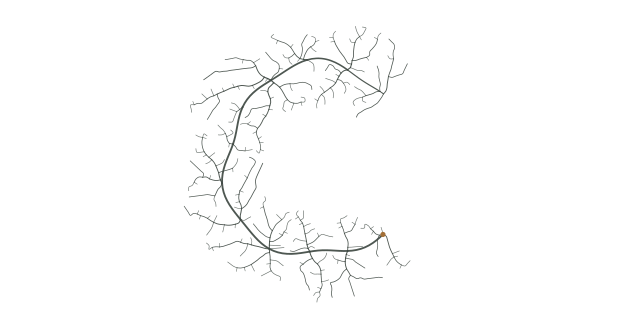

  <picture>
    <source media="(prefers-color-scheme: dark)" srcset="./assets/growth-dark.svg">
    <source media="(prefers-color-scheme: light)" srcset="./assets/growth-light.svg">
    
  </picture>

  nature loves C. 
  C and rust. typescript when it needs a ui.

